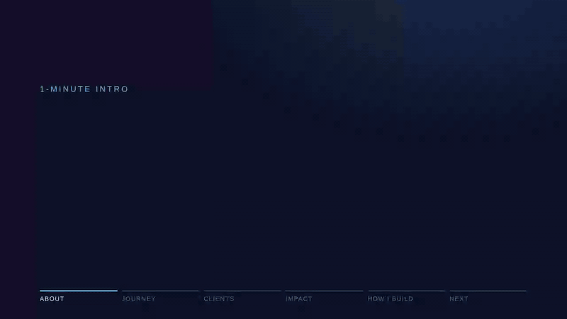

# Prakasam R

**Technology manager, building agentic AI hands-on.** I design AI systems that a business can check before it trusts them: deterministic gates before human sign-off, evals as CI quality gates, and audit trails end to end. 17+ years delivering for life sciences and BFSI clients. Chennai, India.

`LangGraph` · `MCP` · `RAG` · `Multi-model LLMs` · `Amazon Bedrock` · `Azure OpenAI` · `LLMOps & evals` · `AI governance` · `Python` · `R` · `SAS`

**Portfolio page with all demos and links: [grprakasam.github.io](https://grprakasam.github.io)**

**1-minute intro**: my resume as a short animated walkthrough (captions, no audio).

## Projects

| Project | What it does | Evidence |
|---|---|---|
| [**ADAM AI**](https://github.com/grprakasam/adam-ai) | LangGraph agent that turns a CDISC ADaM spec into an R program, runs it in a network-isolated sandbox, checks it against an independent reference and stops for independent human sign-off. Hash-chained audit log, cheap-first model routing, MCP server. | [Pharmaverse ADSL benchmark](https://github.com/grprakasam/adam-ai/blob/main/benchmarks/pharmaverse/results/latest_replay.md) in CI: 28/28 variables, 306 subjects, exact match after one repair loop (replay) · [demo](https://github.com/grprakasam/adam-ai/blob/main/docs/demo/adam-ai-demo.gif) |
| [**agentic-ai-learning-lab**](https://github.com/grprakasam/agentic-ai-learning-lab) | Two tracks. **Built:** converts legacy XML/JSON workflows into Power Automate drafts with deterministic rules first, a bounded LLM with guardrails second, everything else flagged. **Learning:** RAG with retrieval evaluation on AWS with Terraform (design done; build planned from Nov 2026). | [Scorecard](https://github.com/grprakasam/agentic-ai-learning-lab/blob/main/workflow_modernization/results/latest_scorecard.md): 82% of actions converted by rules alone, zero silent failures in 29 behavioral tests (offline, synthetic) · [demo](https://github.com/grprakasam/agentic-ai-learning-lab/blob/main/docs/demo/workflow-modernization-demo.gif) |
| [**AI Exam Builder**](https://github.com/grprakasam/Ai_ExamBuilder_Jan26) | The LLM writes questions and feedback; code decides scores, difficulty and SM-2 mastery. Access-controlled attempts. | Integration tests and build in CI · [demo](https://github.com/grprakasam/Ai_ExamBuilder_Jan26/blob/main/docs/demo/ai-exam-builder-demo.gif) |

## How I build

- Model output is untrusted until a deterministic check passes.
- Every capability states its evidence: unit-tested, replayed, mocked or live.
- Significant decisions are written down as ADRs.

## Elsewhere

[Portfolio page](https://grprakasam.github.io) · [LinkedIn](https://www.linkedin.com/in/grprakasam) · Claude Certified Architect – Foundations (2026) · PharmaSUG US 2022 co-author (R Shiny in clinical programming)
